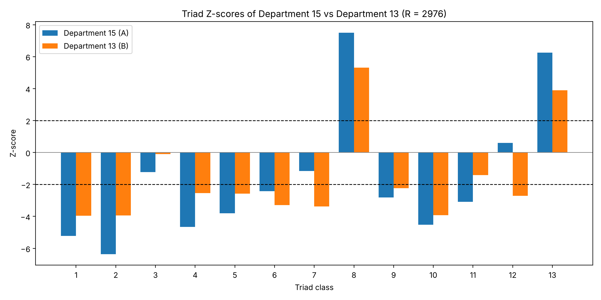

# Finding Network Motifs in an Email Network

CS1005 Discrete Structures, Fall 2026 - course project

## Group

| Name | Roll no. | Section |
| --- | --- | --- |
| Fida Hussain (leader) | 25i-0689 | B |
| Muhammad Shamir Ali Shah | 25i-0717 | A |
| Ahsan Khan | 25i-0535 | B |
| Syed Hamza Haider | 25i-1035 | A |

## R and parameters (T1)

R = 689 + 717 + 535 + 1035 = 2976

- pair number = 2976 mod 190 = 126, so (i, j) = (8, 11)
- Department A = top-20[8] = 15
- Department B = top-20[11] = 13
- random networks = 20 + (2976 mod 31) = 20
- swap attempts = (5 + (2976 mod 6)) x edges = 5 x edges
- seed = 2976

The edge file has 25,571 lines. After removing self-loops and duplicates there are 24,929 edges and 1005 nodes.

Subgraphs (T2): department 15 has 55 nodes and 357 edges, department 13 has 26 nodes and 279 edges.

## How to run

Install the packages with `pip install -r requirements.txt`. The two data files are already in `data/`.
Then run `python motif_project.py`. It takes a few seconds and saves everything in `results/`.
The roll numbers are written in `ROLLS` at the top of the file.

`check_networkx.py` is only a test of our own counting. It compares our counts with `nx.triadic_census`
(we used it only for checking, not for the results). All 13 counts matched for both departments.

## About the code

`motif_project.py` has all the tasks in order T1 to T7.

For T3, `triad_class` writes the triad as a 6-bit number (edge order 0->1, 0->2, 1->0, 1->2, 2->0, 2->1).
At the start we make a table: for each of the 64 numbers we rename the 3 nodes in all 6 ways and keep the smallest number.
The 64 numbers fall into 16 groups, and 13 of them are connected, which are the 13 classes.

For T4 we take every node and every pair of its neighbours, because the node with the pair is always a connected triad.
The same triad can be found from different nodes, so we keep a set of sorted triples and count each one once.

For T5, `randomize` does the swaps (a,b),(c,d) -> (a,d),(c,b) exactly as in the statement, and rejected tries also count.
After every random network we assert that the edge count and every in- and out-degree are the same, with no self-loops or parallel edges.
Each department makes a `random.Random(R)` which gives a new seed to each random network, so the results are the same on every run.

The Z-score uses the population standard deviation (Z = 0 if it is 0).

### T3 hand example

Triad 0->1, 1->2, 2->0. Bit values: 0->1 is 1, 1->2 is 8, 2->0 is 16.
Order (0,1,2) gives 1 + 8 + 16 = 25. Order (0,2,1) gives the edges 0->2, 2->1, 1->0 = 2 + 32 + 4 = 38.
The other orders also give 25 or 38. The smallest is 25, so this triad is class 9.

## Results

### T4 - triad counts in the real subgraphs

| Class | Code | Dept 15 (A) | Dept 13 (B) |
| --- | --- | --- | --- |
| 1 | 3 | 232 | 36 |
| 2 | 6 | 176 | 14 |
| 3 | 7 | 602 | 213 |
| 4 | 10 | 200 | 6 |
| 5 | 11 | 45 | 8 |
| 6 | 15 | 52 | 30 |
| 7 | 21 | 434 | 42 |
| 8 | 23 | 485 | 207 |
| 9 | 25 | 1 | 0 |
| 10 | 27 | 73 | 18 |
| 11 | 30 | 52 | 17 |
| 12 | 31 | 242 | 236 |
| 13 | 63 | 145 | 321 |

### T5 - degree check

In every one of the 20 random networks of both departments the assert passed: same number of edges, same in- and out-degree
for every node, no self-loops and no parallel edges.

### T6 - Z-scores

Motif if Z > 2 and anti-motif if Z < -2.

| Class | Dept 15 (A) | Dept 13 (B) |
| --- | --- | --- |
| 1 | -5.23 anti | -3.95 anti |
| 2 | -6.36 anti | -3.94 anti |
| 3 | -1.23 | -0.10 |
| 4 | -4.65 anti | -2.53 anti |
| 5 | -3.81 anti | -2.58 anti |
| 6 | -2.42 anti | -3.29 anti |
| 7 | -1.16 | -3.38 anti |
| 8 | 7.50 motif | 5.30 motif |
| 9 | -2.81 anti | -2.24 anti |
| 10 | -4.52 anti | -3.92 anti |
| 11 | -3.09 anti | -1.41 |
| 12 | 0.60 | -2.70 anti |
| 13 | 6.25 motif | 3.90 motif |

### T7 - chart

## T8 - how do the two departments communicate differently?

Both departments mostly email each other in both directions. Class 8 (two mutual pairs sharing one person) and
class 13 (everybody emails everybody both ways) are motifs in both, and most one-way patterns like one sender with
two receivers (class 1), chains (class 2) and feed-forward triangles (class 5) and cycles (class 9) are anti-motifs. The difference is the size
and density. Department 15 has 55 people and is not so dense, and its motif signals are stronger (Z = 7.50 for class 8).
Department 13 has only 26 people but is very dense, so the full triangle is about 28% of all its triads, and classes 7 and 12
are also anti-motifs there, but not in department 15. So department 13 works like one small circle where almost everyone talks to everyone,
and department 15 is made of many overlapping two-way pairs.

## Contributions

| Member | Work |
| --- | --- |
| Fida Hussain | GitHub repository, data loading and cleaning, top-20 list and parameters (T1, T2), README |
| Muhammad Shamir Ali Shah | `triad_class` and the triad counting (T3, T4) |
| Ahsan Khan | `randomize`, the degree checks and the Z-scores (T5, T6) |
| Syed Hamza Haider | chart (T7), `check_networkx.py`, T8 |

## References

- Milo et al. (2002), Network Motifs: Simple Building Blocks of Complex Networks, Science 298(5594), 824-827.
- SNAP email-Eu-core: https://snap.stanford.edu/data/email-Eu-core.html
